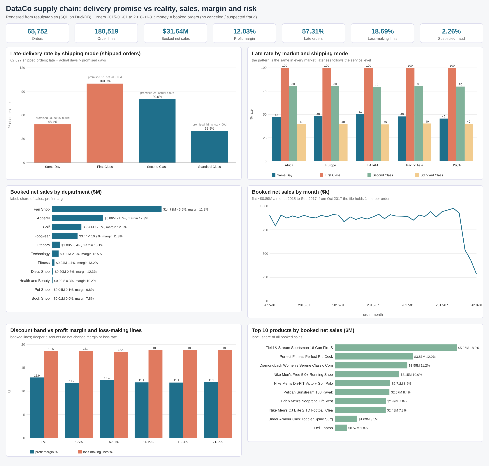
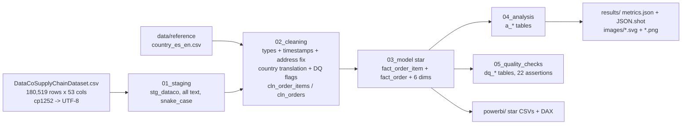
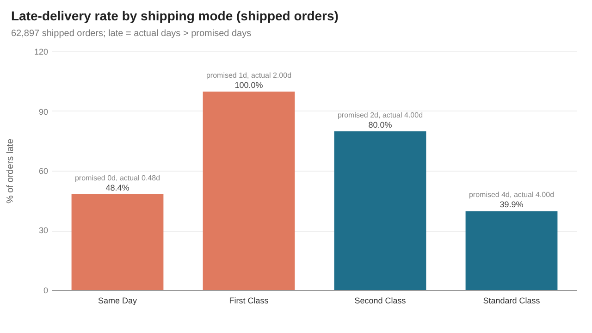
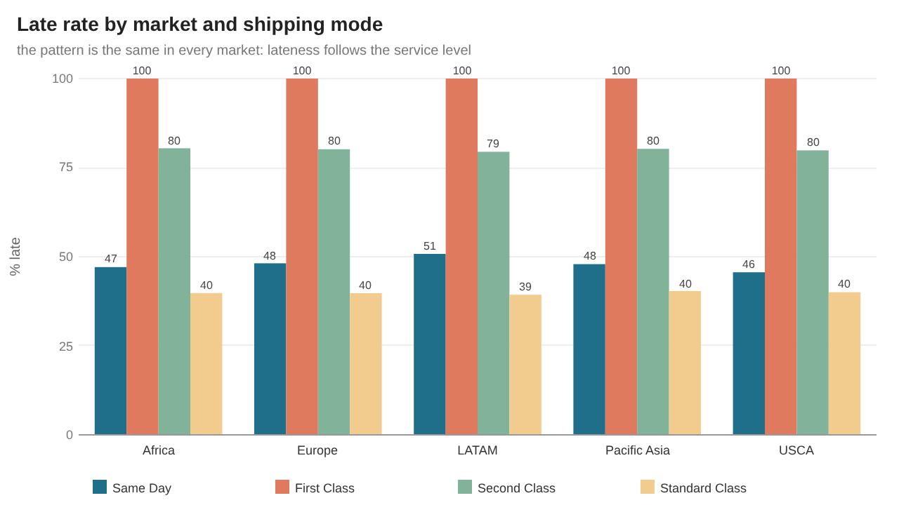
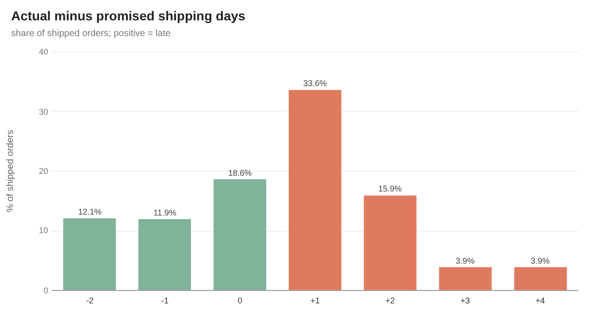
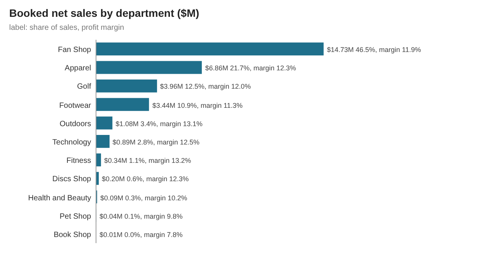
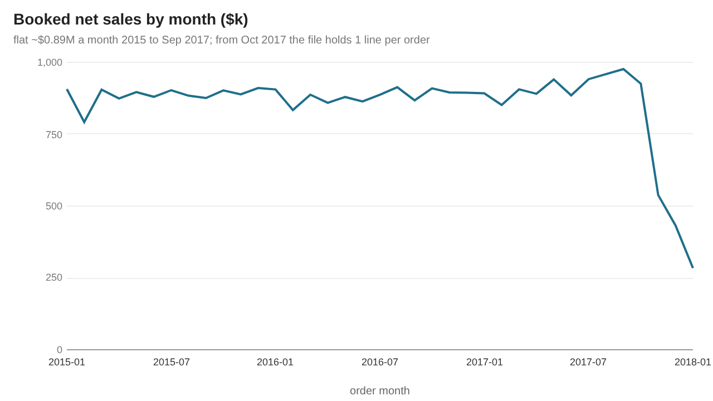
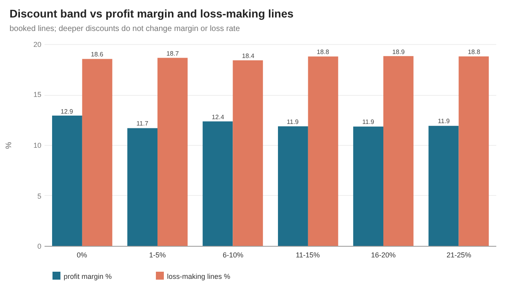
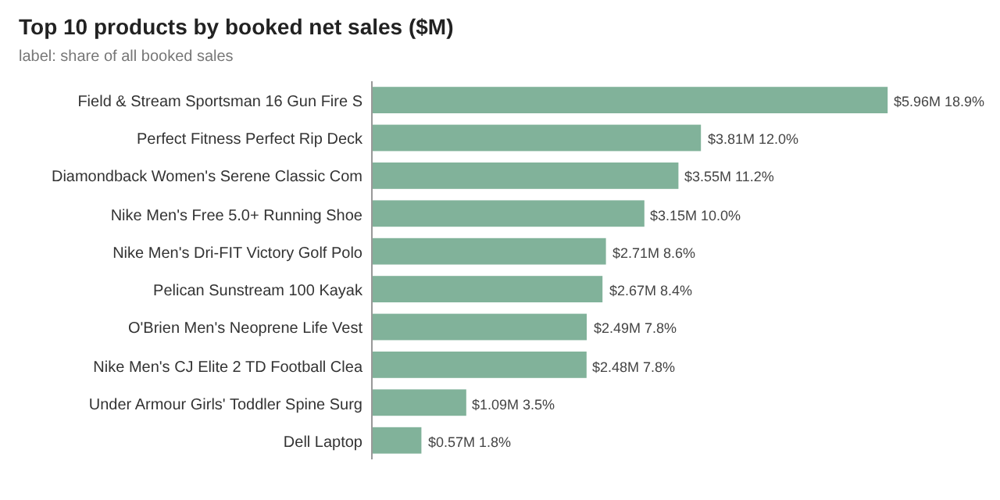
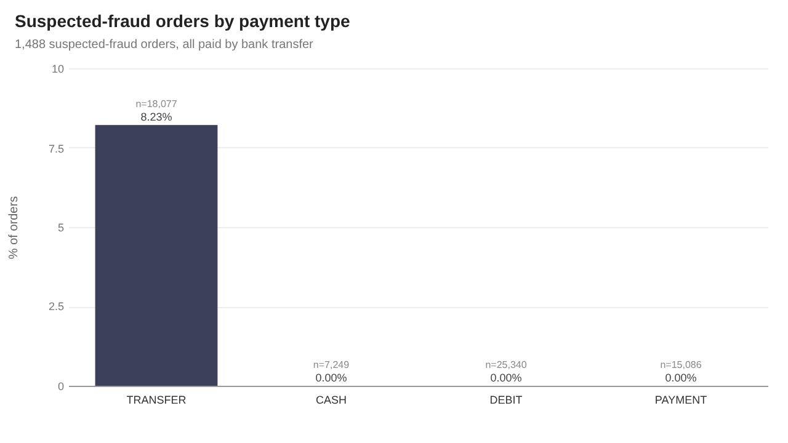

# da-learn-10 · Supply chain analytics (DataCo Smart Supply Chain)

A data-analyst learning project. It analyses the **DataCo Smart Supply Chain dataset (180,519 order lines → 65,752 orders, 20,652 customers, 118 products, 164 destination countries, Jan 2015 – Jan 2018)** published on Mendeley Data and mirrored on Kaggle. The raw CSV goes through SQL staging, cleaning (encoding, type and timestamp parsing, a column-shift repair, Spanish → English country names, PII and redundant-column removal), a star schema, analysis and quality checks. DuckDB runs the whole pipeline locally on the **full** file. The outputs are a Power BI kit plus SVG and PNG charts in `results/images/`.

> **Databricks was skipped** for this project because the Databricks workspace hit its resource quota. There is no live Lakeview dashboard; the SQL stays Databricks/Spark-compatible (DuckDB shims are isolated in `sql/00`), and all charts and KPIs are in [`results/`](results/RESULTS.md).



## Business questions
1. How big is the business (orders, lines, customers, products, markets), and what are booked sales, profit and margin?
2. How often does DataCo keep its delivery promise, and is lateness driven by the shipping mode or by geography?
3. Which departments, categories and products drive sales, and how concentrated is revenue?
4. Do discounts or late deliveries erode margin? How many order lines lose money?
5. Where is suspected fraud concentrated (payment type, region)?
6. How do sales and lateness move over time, and is the file consistent across the whole period?
7. How clean is the raw file (encoding, shifted columns, masked PII, duplicated columns, empty columns)?

## Pipeline


## Headline insights (full data)
- **Scale:** 65,752 orders (180,519 lines) from 20,652 customers, shipped to 164 countries in 5 markets. Booked orders (excluding canceled and suspected-fraud ones) bring **$31.64M net sales** and **$3.81M profit, a 12.03% margin**; the average booked order is $503.12 after an average 10.14% discount.
- **The delivery promise is broken by design:** **57.31%** of shipped orders arrive late (18.64% on time, 24.05% early). **First Class is late 100% of the time**: it promises 1 day and always takes 2. Second Class is late 79.99% (promises 2 days, averages 4.00), Same Day 48.37%, and Standard Class 39.85% (promises 4, averages 3.995). Late rates are almost identical in every market (56.6–57.7%) and region (52.6–60.0%), so the cause is the service-level promise, not geography.
- **Revenue is concentrated:** Fan Shop is 46.55% of booked sales and Apparel 21.67%. The top 10 of 118 products bring **89.99%** of sales; the Field & Stream Sportsman 16 Gun Fire Safe alone is 18.85% ($5.96M). The US ($4.19M), France ($2.48M) and Mexico ($2.27M) are the biggest destinations.
- **Margins don't respond to discounts or delays:** margin stays between 11.71% and 12.95% across every discount band, and the share of loss-making lines stays at 18.4–18.9%. Late lines earn 11.83% vs 12.38% on time. Still, **18.69% of booked lines lose money**, about $3.71M of losses against $3.81M of total profit.
- **Fraud is all bank transfers:** all 1,488 suspected-fraud orders (2.26% of orders) were paid by TRANSFER, which is 8.23% of transfer orders; cash, debit and online payment have none. West of USA (10.41% of transfers) and Canada (11.0%) have the highest rates.
- **Period caveat:** sales run flat between $0.79M and $0.98M a month (average $0.89M) from Jan 2015 to Sep 2017. From Oct 2017 every order has exactly one line and only 8–20 products appear a month, so sales fall to $0.28M by Jan 2018. Those 8,403 orders are kept and flagged `is_late_2017_regime`.
- **Data quality:** 22 / 22 assertions pass. The file is Windows-1252 encoded; 3 customer addresses are shifted one column and repaired; 124,846 lines have Spanish country names translated; 5 PII or masked columns, 2 empty or constant columns, and 6 duplicate columns (identity asserted) are dropped.

## Charts
All charts are in `results/images/` as SVG (plain vector shapes) and PNG (2x render of the same SVG).

| | |
|---|---|
|  |  |
|  |  |
|  |  |
|  |  |

## How to run
```bash
pip install -r requirements.txt
python run_pipeline.py --source sample       # committed 903-line sample in data/raw/, results in results/sample/
python scripts/download_full_data.py         # ~96 MB into data/raw_full/ (SHA-256 checked, Mendeley first, GitHub mirror fallback)
python run_pipeline.py --source full         # full file: results/, data/clean/, powerbi/data/
python scripts/render_png.py                 # results/images/*.svg -> *.png with headless Chrome
```
`scripts/make_sample.py` rebuilds the committed sample from the full file.

## Repo layout
```
data/raw/            903-line raw sample (322 orders, every cleaning rule exercised); full file via scripts/download_full_data.py
data/reference/      country_es_en.csv: Spanish -> English names for all 164 order countries
data/raw_full.sha256 checksums of the UTF-8 full files the pipeline reads
data/clean/          cleaned CSVs + star (produced by --source full; gitignored, ~140 MB; regenerate locally)
sql/                 00 DuckDB shims, 01 staging, 02 cleaning, 03 star model, 04 analysis, 05 quality checks
run_pipeline.py      DuckDB runner (sample | full)
scripts/             project config, sample builder, downloader, SVG chart writer, PNG renderer
results/             RESULTS.md, metrics.json, JSON.shot, tables/*.csv, images/*.svg + *.png (dashboard = overview)
powerbi/             full star CSVs (~40 MB), measures.dax, model.md, dashboard_spec.md, BUILD_GUIDE.md
```

## Caveats
- DataCo is a **teaching dataset** published by its authors for supply-chain analytics. Patterns like a constant ~12% margin in every segment and fixed shipping times per mode suggest it is generated or heavily stylised, so treat the insights as practice, not market facts.
- Product-to-category links are odd in the source (for example the gun safe sits under "Fishing" and a Nike golf polo under "Women's Apparel"). They are kept as published.
- "Benefit per order" and "Order Profit Per Order" are **order-line** values despite their names (identical columns); profit KPIs sum lines.
- Money KPIs exclude CANCELED and SUSPECTED_FRAUD orders (2,855 orders); delivery KPIs exclude "Shipping canceled" (the same 2,855 orders). Lines with other statuses (pending, on hold, payment review) count as booked.
- January 2018 is the last month, and the Oct 2017 – Jan 2018 orders follow a different shape (one line per order, few products); year-over-year comparisons should stop at Sep 2017.
- Customer names, street, e-mail and password (the last two already masked as `XXXXXXXXX`) are dropped. `order_zipcode` is 86.24% empty and not used.

## Complete dataset
- **Kaggle page:** https://www.kaggle.com/datasets/shashwatwork/dataco-smart-supply-chain-for-big-data-analysis ("DataCo SMART SUPPLY CHAIN FOR BIG DATA ANALYSIS", uploaded by Shashwat Tiwari)
- **Original source:** Constante, Fabian; Silva, Fernando; Pereira, António (2019), "DataCo SMART SUPPLY CHAIN FOR BIG DATA ANALYSIS", Mendeley Data, V5, doi:[10.17632/8gx2fvg2k6.5](https://data.mendeley.com/datasets/8gx2fvg2k6/5)
- **Mirrors used (exact URLs):**
  - https://data.mendeley.com/public-files/datasets/8gx2fvg2k6/files/72784be5-36d3-44fe-b75d-0edbf1999f65/file_downloaded (`DataCoSupplyChainDataset.csv`, SHA-256 `fa6d022ed437155e1a2f0378710602848703c8a7f203f7ff5d77805bf8480aa6`)
  - https://data.mendeley.com/public-files/datasets/8gx2fvg2k6/files/29dc7b05-dda6-4834-8354-5b5cc44430df/file_downloaded (`DescriptionDataCoSupplyChain.csv`, SHA-256 `9828e34669bd6d77e3b4463364cc44a5d52446b5e246fc258758cfe592566c4b`)
  - Fallback (same bytes with LF line endings): https://raw.githubusercontent.com/McGill-MMA-EnterpriseAnalytics/DataCo_Supply_Chain/main/data/raw/DataCoSupplyChainDataset.csv (SHA-256 `994b3c8d24049cc46bf20e8161fedece9a9b95376cc0dc929921d76cf6b9bc0d`)
- **Licence:** CC BY 4.0 (Mendeley Data record). Cite the authors above when reusing.
- **Total size:** 95,910,149 bytes (~95.9 MB) for the order file plus 3,444 bytes for the column description. The same record also has `tokenized_access_logs.csv` (95,446,364 bytes of web click logs), which this project does not use.
- **Files:** `DataCoSupplyChainDataset.csv`: 180,519 rows × 53 columns (`Type, Days for shipping (real), Days for shipment (scheduled), Benefit per order, Sales per customer, Delivery Status, Late_delivery_risk, Category Id, Category Name, Customer City, Customer Country, Customer Email, Customer Fname, Customer Id, Customer Lname, Customer Password, Customer Segment, Customer State, Customer Street, Customer Zipcode, Department Id, Department Name, Latitude, Longitude, Market, Order City, Order Country, Order Customer Id, order date (DateOrders), Order Id, Order Item Cardprod Id, Order Item Discount, Order Item Discount Rate, Order Item Id, Order Item Product Price, Order Item Profit Ratio, Order Item Quantity, Sales, Order Item Total, Order Profit Per Order, Order Region, Order State, Order Status, Order Zipcode, Product Card Id, Product Category Id, Product Description, Product Image, Product Name, Product Price, Product Status, shipping date (DateOrders), Shipping Mode`); `DescriptionDataCoSupplyChain.csv`: field descriptions.
- **Download:** `python scripts/download_full_data.py` (writes UTF-8 copies to data/raw_full/ and verifies SHA-256)
