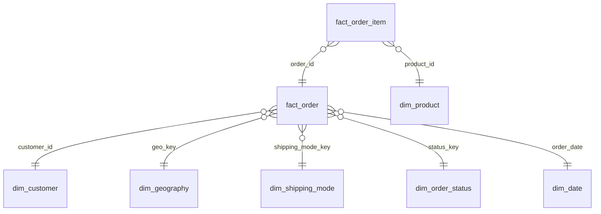

# Power BI model - da-learn-10 Supply chain (DataCo)

Import every CSV in `powerbi/data/` (full data: 180,519 order lines / 65,752 orders; built by `python run_pipeline.py --source full`). Total size of the star CSVs is ~40 MB (fact_order_item 29 MB, fact_order 11 MB).

| Table | Grain | Key | Notes |
|---|---|---|---|
| fact_order_item | order line | order_item_id | quantity, unit_price, gross / discount / net sales, profit, discount_band, is_loss, outlier flag; also carries the order's keys and delivery fields |
| fact_order | order | order_id | order date, ship date, days_real vs days_scheduled, delay_days, late_flag, delivery_outcome, is_booked, is_suspected_fraud, totals |
| dim_customer | customer | customer_id | 20,652 customers; segment, city, state, zip, country (names / e-mail / street dropped) |
| dim_product | product | product_id | 118 products; category, department, list price, image URL |
| dim_geography | destination | geo_key | 3,772 market × region × country × state × city rows; country in English |
| dim_shipping_mode | shipping mode | shipping_mode_key | 4 modes with promised_days (0 / 1 / 2 / 4) |
| dim_order_status | order status | status_key | 9 statuses, the one payment type each maps to, is_booked |
| dim_date | calendar day | date_key | 1,133 days covering every order and ship date; year_month, is_late_2017_regime |

## Relationships
- `fact_order_item[order_id]` → `fact_order[order_id]` (many-to-one, cross-filter **Both** so order-level slicers such as market or shipping mode filter lines)
- `fact_order_item[product_id]` → `dim_product[product_id]` (many-to-one)
- `fact_order[customer_id]` → `dim_customer[customer_id]` (many-to-one)
- `fact_order[geo_key]` → `dim_geography[geo_key]` (many-to-one)
- `fact_order[shipping_mode_key]` → `dim_shipping_mode[shipping_mode_key]` (many-to-one)
- `fact_order[status_key]` → `dim_order_status[status_key]` (many-to-one)
- `fact_order[order_date]` → `dim_date[date_key]` (many-to-one, active); `fact_order[ship_date]` → `dim_date[date_key]` (inactive, use with USERELATIONSHIP)
- Mark `dim_date` as the date table. Sort `fact_order_item[discount_band]` by itself (it carries a letter prefix).
